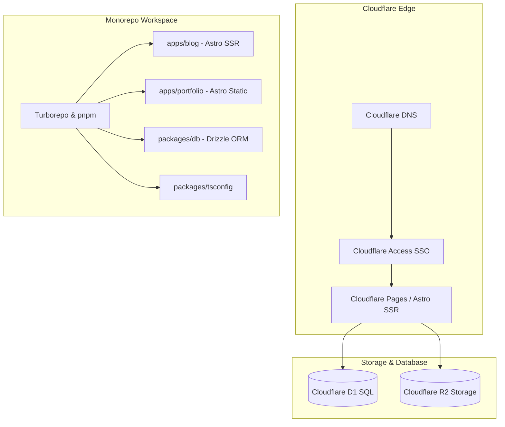

# Refined Blog Project Strategy Plan (plan1.md)

This document outlines the complete strategy, architecture, tech-stack, database schema, API routes, and deployment plan for the new refined blog project. It is designed as a production-ready blueprint to be executed with surgical precision.

---

## 1. Executive Summary & Goals

The goal of this project is to rebuild and refine the previous blog project into a modern, high-performance, edge-native blog and portfolio monorepo. By leveraging the Cloudflare ecosystem, we eliminate server maintenance, minimize operational costs (near-zero at scale), and achieve extreme performance.

### Core Objectives:
*   **Zero-Trust Security**: Replace custom authentication, session management, and 2FA with **Cloudflare Access (Zero Trust)**. This secures the admin area at the edge before requests even reach our server.
*   **Edge-First Performance**: Use **Astro v5** with the Cloudflare SSR adapter. Public pages will leverage hybrid rendering (Static/ISR) for sub-millisecond load times, while admin pages and API routes run dynamically on Cloudflare Workers.
*   **Zero-Egress Media Hosting**: Use **Cloudflare R2** for storing images and media, eliminating S3 egress fees entirely.
*   **Structured Content Editing**: Replace Tiptap with **Editor.js**, storing clean, structured JSON in **Cloudflare D1**.
*   **Unified Monorepo Developer Experience**: Use **pnpm workspaces** and **Turborepo** to manage the blog, portfolio, and shared database packages in a single repository.

---

## 2. Monorepo Architecture & Tech Stack



### Tech Stack Details:
*   **Monorepo Engine**: `pnpm` + `Turborepo v2`.
*   **Frontend/Backend Framework**: `Astro v5` (using `@astrojs/cloudflare` adapter).
*   **Database**: `Cloudflare D1` (Serverless SQLite).
*   **ORM**: `Drizzle ORM` + `Drizzle Kit` (for migrations and schema management).
*   **Media Storage**: `Cloudflare R2` (S3-compatible).
*   **Authentication**: `Cloudflare Access` (Zero Trust SSO).
*   **Rich Text Editor**: `Editor.js` (React wrapper) with custom server-side block rendering.
*   **Styling**: `Tailwind CSS v4` (native in Astro v5).

---

## 3. Monorepo Directory Structure

We will structure the project as a clean monorepo. This allows us to share TypeScript configurations and the database schema between the blog and the portfolio.

```text
akiblog/
├── apps/
│   ├── blog/                 # Astro (Hybrid Static/SSR)
│   │   ├── src/
│   │   │   ├── assets/       # Static assets (logos, icons)
│   │   │   ├── components/
│   │   │   │   ├── BlockRenderer.astro # Server-side Editor.js JSON renderer
│   │   │   │   ├── Editor.tsx          # React wrapper for Editor.js
│   │   │   │   ├── Footer.astro
│   │   │   │   ├── Header.astro
│   │   │   │   └── ThemeToggle.astro
│   │   │   ├── layouts/
│   │   │   │   └── Layout.astro
│   │   │   ├── pages/
│   │   │   │   ├── index.astro         # Public blog list (Static/ISR)
│   │   │   │   ├── posts/
│   │   │   │   │   └── [slug].astro    # Public blog post (Static/ISR)
│   │   │   │   ├── admin/              # Protected by Cloudflare Access
│   │   │   │   │   ├── index.astro     # Post management dashboard
│   │   │   │   │   ├── write.astro     # Editor.js writing interface (New)
│   │   │   │   │   └── edit/
│   │   │   │   │       └── [id].astro  # Editor.js editing interface (Edit)
│   │   │   │   └── api/
│   │   │   │       ├── posts/
│   │   │   │       │   ├── index.ts    # GET (list) / POST (create)
│   │   │   │       │   └── [id].ts     # PUT (update) / DELETE (delete)
│   │   │   │       ├── comments/
│   │   │   │       │   ├── index.ts    # POST (create comment)
│   │   │   │       │   └── [id].ts     # PUT (approve) / DELETE (delete)
│   │   │   │       ├── tags.ts         # GET / POST / DELETE tags
│   │   │   │       └── upload.ts       # POST image to R2
│   │   │   ├── styles/
│   │   │   │   └── global.css          # Tailwind CSS v4 styles
│   │   │   └── env.d.ts
│   │   ├── astro.config.mjs
│   │   ├── package.json
│   │   ├── tsconfig.json
│   │   └── wrangler.toml             # Cloudflare bindings (D1, R2)
│   │
│   └── portfolio/            # Astro (Static site)
│       ├── src/
│       │   └── pages/
│       │       └── index.astro
│       ├── astro.config.mjs
│       ├── package.json
│       └── tsconfig.json
│
├── packages/
│   ├── db/                   # Shared Drizzle schema and migrations
│   │   ├── migrations/       # SQL migrations generated by Drizzle Kit
│   │   ├── src/
│   │   │   ├── index.ts      # Exports db client and schemas
│   │   │   └── schema.ts     # Drizzle schema definition
│   │   ├── drizzle.config.ts # Drizzle Kit configuration
│   │   └── package.json
│   │
│   └── tsconfig/             # Shared TypeScript configurations
│       ├── base.json
│       └── package.json
│
├── package.json              # Monorepo root package.json
├── pnpm-workspace.yaml       # pnpm workspace configuration
└── turbo.json                # Turborepo configuration
```

---

## 4. Database Schema Design (Drizzle ORM)

By migrating to Cloudflare Access, we completely eliminate the need for `admin_users`, `sessions`, and `2fa_codes` tables. Instead, we store the author's email (extracted from the Cloudflare Access JWT) directly in the `posts` table.

Here is the complete schema design for `packages/db/src/schema.ts`:

```typescript
import { sqliteTable, text, integer, primaryKey } from 'drizzle-orm/sqlite-core';
import { sql } from 'drizzle-orm';

// Blog Posts Table
export const posts = sqliteTable('posts', {
  id: text('id').primaryKey(), // We will use ULIDs or UUIDs for post IDs
  slug: text('slug').notNull().unique(),
  title: text('title').notNull(),
  excerpt: text('excerpt'),
  content: text('content').notNull(), // Stores Editor.js JSON string
  coverImage: text('cover_image'),   // URL pointing to R2 storage
  status: text('status', { enum: ['draft', 'published', 'archived'] }).notNull().default('draft'),
  authorEmail: text('author_email').notNull(), // Extracted from Cloudflare Access JWT
  allowComments: integer('allow_comments', { mode: 'boolean' }).notNull().default(true),
  publishedAt: integer('published_at', { mode: 'timestamp' }),
  createdAt: integer('created_at', { mode: 'timestamp' })
    .notNull()
    .default(sql`(strftime('%s', 'now') * 1000)`),
  updatedAt: integer('updated_at', { mode: 'timestamp' })
    .notNull()
    .default(sql`(strftime('%s', 'now') * 1000)`),
});

// Tags Table
export const tags = sqliteTable('tags', {
  id: text('id').primaryKey(), // Tag ID
  name: text('name').notNull().unique(),
  slug: text('slug').notNull().unique(),
  color: text('color').notNull().default('#3B82F6'),
  createdAt: integer('created_at', { mode: 'timestamp' })
    .notNull()
    .default(sql`(strftime('%s', 'now') * 1000)`),
});

// Blog Post <-> Tag Junction Table
export const postTags = sqliteTable('post_tags', {
  postId: text('post_id')
    .notNull()
    .references(() => posts.id, { onDelete: 'cascade' }),
  tagId: text('tag_id')
    .notNull()
    .references(() => tags.id, { onDelete: 'cascade' }),
}, (t) => ({
  pk: primaryKey({ columns: [t.postId, t.tagId] }),
}));

// Comments Table
export const comments = sqliteTable('comments', {
  id: text('id').primaryKey(), // Comment ID
  postId: text('post_id')
    .notNull()
    .references(() => posts.id, { onDelete: 'cascade' }),
  parentId: text('parent_id'), // For nested replies (self-referencing)
  authorName: text('author_name').notNull(),
  authorEmail: text('author_email').notNull(),
  content: text('content').notNull(),
  isApproved: integer('is_approved', { mode: 'boolean' }).notNull().default(false),
  ipAddress: text('ip_address'),
  userAgent: text('user_agent'),
  createdAt: integer('created_at', { mode: 'timestamp' })
    .notNull()
    .default(sql`(strftime('%s', 'now') * 1000)`),
});
```

---

## 5. Cloudflare Access & JWT Verification

Cloudflare Access intercepts requests to our `/admin/*` pages and `/api/*` write endpoints. It authenticates users via your configured SSO (Google, GitHub, Magic Link, etc.) and forwards a JWT token in the `Cf-Access-Jwt-Assertion` header.

To ensure absolute security, our API routes will verify this JWT. This prevents any unauthorized requests from bypassing the edge (e.g., during local development or direct worker URL access).

### JWT Verification Helper (`apps/blog/src/lib/auth.ts`):

```typescript
import { jwtVerify, createRemoteJWKSet } from 'jose';

interface AccessJWTPayload {
  email: string;
  common_name: string;
  [key: string]: any;
}

export async function verifyAccessJWT(request: Request, env: any): Promise<AccessJWTPayload | null> {
  const jwt = request.headers.get('Cf-Access-Jwt-Assertion');
  if (!jwt) {
    // For local development, we can mock authentication if a flag is enabled
    if (env.DEV_MODE === 'true' || env.SITE_URL.includes('localhost')) {
      return {
        email: 'admin@akib35.me',
        common_name: 'Local Admin',
      };
    }
    return null;
  }

  try {
    // Cloudflare Access JWKS endpoint
    const teamDomain = env.CLOUDFLARE_TEAM_DOMAIN; // e.g., "akib35.cloudflareaccess.com"
    const JWKS = createRemoteJWKSet(new URL(`https://${teamDomain}/cdn-cgi/access/certs`));

    const { payload } = await jwtVerify(jwt, JWKS, {
      issuer: `https://${teamDomain}`,
      audience: env.CLOUDFLARE_ACCESS_AUD, // Cloudflare Access Application AUD tag
    });

    return payload as AccessJWTPayload;
  } catch (error) {
    console.error('JWT Verification Failed:', error);
    return null;
  }
}
```

---

## 6. Editor.js Integration & Public Block Rendering

### A. React Editor Component (`apps/blog/src/components/Editor.tsx`)

We will wrap Editor.js in a React component. Astro will load this component dynamically with `client:only="react"` inside the admin panel.

```tsx
import React, { useEffect, useRef } from 'react';
import EditorJS from '@editorjs/editorjs';
import Header from '@editorjs/header';
import List from '@editorjs/list';
import CodeTool from '@editorjs/code';
import ImageTool from '@editorjs/image';
import InlineCode from '@editorjs/inline-code';
import Quote from '@editorjs/quote';
import Table from '@editorjs/table';

interface EditorProps {
  initialData?: any;
  onChange: (data: any) => void;
}

export default function Editor({ initialData, onChange }: EditorProps) {
  const editorRef = useRef<EditorJS | null>(null);

  useEffect(() => {
    if (!editorRef.current) {
      const editor = new EditorJS({
        holder: 'editorjs-container',
        data: initialData ? JSON.parse(initialData) : {},
        placeholder: 'Start writing your masterpiece...',
        tools: {
          header: {
            class: Header,
            config: {
              placeholder: 'Enter a header',
              levels: [2, 3, 4],
              defaultLevel: 2
            }
          },
          list: {
            class: List,
            inlineToolbar: true,
            config: {
              defaultStyle: 'unordered'
            }
          },
          code: CodeTool,
          inlineCode: InlineCode,
          quote: {
            class: Quote,
            inlineToolbar: true,
            config: {
              quotePlaceholder: 'Enter a quote',
              captionPlaceholder: 'Author'
            }
          },
          table: {
            class: Table,
            inlineToolbar: true
          },
          image: {
            class: ImageTool,
            config: {
              endpoints: {
                byFile: '/api/upload', // Points to our R2 upload API
              },
              field: 'image'
            }
          }
        },
        async onChange() {
          const content = await editor.save();
          onChange(content);
        }
      });

      editorRef.current = editor;
    }

    return () => {
      if (editorRef.current) {
        editorRef.current.destroy();
        editorRef.current = null;
      }
    };
  }, []);

  return (
    <div className="w-full bg-white dark:bg-slate-900 border border-slate-200 dark:border-slate-800 rounded-xl p-6 shadow-sm">
      <div id="editorjs-container" className="prose dark:prose-invert max-w-none min-h-[500px]" />
    </div>
  );
}
```

### B. Server-Side Block Renderer (`apps/blog/src/components/BlockRenderer.astro`)

To render the structured JSON blocks on the public frontend with zero client-side JavaScript, we will create a server-side Astro component. This maps each block type directly to styled Tailwind HTML.

```astro
---
interface Block {
  type: string;
  data: {
    text?: string;
    level?: number;
    style?: 'ordered' | 'unordered';
    items?: string[];
    code?: string;
    language?: string;
    file?: { url: string };
    caption?: string;
    content?: string[][];
    alignment?: string;
  };
}

interface Props {
  contentJson: string;
}

const { contentJson } = Astro.props;

let blocks: Block[] = [];
try {
  const parsed = JSON.parse(contentJson);
  blocks = parsed.blocks || [];
} catch (e) {
  console.error("Failed to parse block content:", e);
}
---

<div class="blog-content space-y-6">
  {blocks.map((block) => {
    switch (block.type) {
      case 'paragraph':
        return <p class="text-slate-700 dark:text-slate-300 leading-relaxed text-lg" set:html={block.data.text} />;

      case 'header':
        const Level = `h${block.data.level || 2}` as any;
        const headingId = block.data.text
          ? block.data.text.toLowerCase().replace(/[^a-z0-9]+/g, '-').replace(/(^-|-$)/g, '')
          : '';
        return (
          <Level id={headingId} class="font-display font-bold text-slate-900 dark:text-slate-100 mt-8 mb-4 scroll-mt-20">
            <a href={`#${headingId}`} class="hover:underline" set:html={block.data.text} />
          </Level>
        );

      case 'list':
        const ListTag = block.data.style === 'ordered' ? 'ol' : 'ul';
        const listClass = block.data.style === 'ordered' ? 'list-decimal pl-6 space-y-2' : 'list-disc pl-6 space-y-2';
        return (
          <ListTag class={`${listClass} text-slate-700 dark:text-slate-300 text-lg`}>
            {block.data.items?.map((item) => (
              <li set:html={item} />
            ))}
          </ListTag>
        );

      case 'code':
        return (
          <div class="relative my-6 rounded-lg overflow-hidden border border-slate-200 dark:border-slate-800 bg-slate-50 dark:bg-slate-950">
            <div class="flex items-center justify-between px-4 py-2 border-b border-slate-200 dark:border-slate-800 bg-slate-100/50 dark:bg-slate-900/50">
              <span class="text-xs font-mono text-slate-500 dark:text-slate-400">{block.data.language || 'code'}</span>
            </div>
            <pre class="p-4 overflow-x-auto font-mono text-sm text-slate-800 dark:text-slate-200"><code>{block.data.code}</code></pre>
          </div>
        );

      case 'quote':
        return (
          <blockquote class="border-l-4 border-slate-400 dark:border-slate-600 pl-4 italic my-6">
            <p class="text-slate-600 dark:text-slate-400 text-lg" set:html={block.data.text} />
            {block.data.caption && <cite class="block text-sm text-slate-500 dark:text-slate-500 mt-2">— {block.data.caption}</cite>}
          </blockquote>
        );

      case 'image':
        return (
          <figure class="my-8 space-y-2">
            
            {block.data.caption && (
              <figcaption class="text-center text-sm text-slate-500 dark:text-slate-400 italic">
                {block.data.caption}
              </figcaption>
            )}
          </figure>
        );

      case 'table':
        return (
          <div class="overflow-x-auto my-6 border border-slate-200 dark:border-slate-800 rounded-lg">
            <table class="min-w-full divide-y divide-slate-200 dark:divide-slate-800">
              <tbody class="divide-y divide-slate-200 dark:divide-slate-800 bg-white dark:bg-slate-900">
                {block.data.content?.map((row, rowIndex) => (
                  <tr class={rowIndex === 0 ? "bg-slate-50 dark:bg-slate-950 font-semibold" : ""}>
                    {row.map((cell) => (
                      <td class="px-4 py-3 text-sm text-slate-700 dark:text-slate-300" set:html={cell} />
                    ))}
                  </tr>
                ))}
              </tbody>
            </table>
          </div>
        );

      default:
        return null;
    }
  })}
</div>
```

---

## 7. API Route Specifications

All write operations (`POST`, `PUT`, `DELETE`) will be protected by verifying the Cloudflare Access JWT.

### A. R2 Image Upload Endpoint (`apps/blog/src/pages/api/upload.ts`)
Handles uploading images directly from Editor.js to Cloudflare R2.

```typescript
import type { APIRoute } from 'astro';
import { verifyAccessJWT } from '../../lib/auth';

export const POST: APIRoute = async ({ request, locals }) => {
  const env = (locals as any).runtime.env;

  // 1. Authenticate Request
  const user = await verifyAccessJWT(request, env);
  if (!user) {
    return new Response(JSON.stringify({ success: 0, error: 'Unauthorized' }), { status: 401 });
  }

  try {
    const formData = await request.formData();
    const file = formData.get('image') as File;
    if (!file) {
      return new Response(JSON.stringify({ success: 0, error: 'No file provided' }), { status: 400 });
    }

    // Generate unique key
    const fileExtension = file.name.split('.').pop();
    const key = `uploads/${crypto.randomUUID()}.${fileExtension}`;

    // Upload directly to Cloudflare R2
    await env.BUCKET.put(key, file.stream(), {
      httpMetadata: { contentType: file.type }
    });

    // R2 Custom Domain URL
    const imageUrl = `${env.R2_PUBLIC_DOMAIN}/${key}`;

    return new Response(JSON.stringify({
      success: 1,
      file: { url: imageUrl }
    }), { status: 200 });

  } catch (error: any) {
    return new Response(JSON.stringify({ success: 0, error: error.message }), { status: 500 });
  }
};
```

### B. Blog Posts API Endpoint (`apps/blog/src/pages/api/posts/index.ts`)
Handles listing posts (public) and creating new posts (admin).

```typescript
import type { APIRoute } from 'astro';
import { verifyAccessJWT } from '../../../lib/auth';
import { db, posts } from '../../../../../packages/db/src'; // Shared Drizzle package

// GET: List all posts (Public)
export const GET: APIRoute = async ({ locals }) => {
  try {
    const database = db(locals.runtime.env.DB);
    const allPosts = await database.select().from(posts).all();
    return new Response(JSON.stringify(allPosts), { status: 200 });
  } catch (error: any) {
    return new Response(JSON.stringify({ error: error.message }), { status: 500 });
  }
};

// POST: Create a new post (Admin Only)
export const POST: APIRoute = async ({ request, locals }) => {
  const env = locals.runtime.env;
  
  // Authenticate
  const user = await verifyAccessJWT(request, env);
  if (!user) {
    return new Response(JSON.stringify({ error: 'Unauthorized' }), { status: 401 });
  }

  try {
    const body = await request.json();
    const database = db(env.DB);

    const newPostId = crypto.randomUUID();
    await database.insert(posts).values({
      id: newPostId,
      title: body.title,
      slug: body.slug,
      content: JSON.stringify(body.content),
      coverImage: body.coverImage,
      status: body.status || 'draft',
      authorEmail: user.email,
      publishedAt: body.status === 'published' ? new Date() : null,
    }).run();

    return new Response(JSON.stringify({ success: true, id: newPostId }), { status: 201 });
  } catch (error: any) {
    return new Response(JSON.stringify({ error: error.message }), { status: 500 });
  }
};
```

---

## 8. Migration & Deployment Strategy

### Step 1: Initialize the Monorepo
1. Create the root `package.json`, `pnpm-workspace.yaml`, and `turbo.json`.
2. Scaffold `packages/tsconfig` and `packages/db`.
3. Move the previous blog project into `apps/blog`.
4. Scaffold `apps/portfolio`.

### Step 2: Database Migration (Drizzle Kit)
We will define our schema in `packages/db/src/schema.ts` and use Drizzle Kit to generate migrations.
1. Run `pnpm --filter db drizzle-kit generate` to generate the SQL migrations.
2. Run `pnpm --filter db drizzle-kit up` to verify.
3. Apply migrations locally: `wrangler d1 execute blog-db --local --file=./packages/db/migrations/0000_initial.sql`.
4. Apply migrations to production: `wrangler d1 execute blog-db --remote --file=./packages/db/migrations/0000_initial.sql`.

### Step 3: Cloudflare Access Configuration
1. In Cloudflare Dashboard, go to **Zero Trust** -> **Access** -> **Applications**.
2. Add a **Self-Hosted** application.
3. Domain: `blog.akib35.me/admin/*` and `blog.akib35.me/api/posts/*` (for write methods).
4. Configure an identity provider (e.g., GitHub or Google) and create a policy allowing only your email.
5. Copy the **Application Audience (AUD) Tag** and add it to your Cloudflare Pages environment variables as `CLOUDFLARE_ACCESS_AUD`.

---

## 9. Local Development Workflow

To make local development seamless, we will emulate Cloudflare D1 and R2 using Wrangler.

### Running the Monorepo:
```bash
# Install dependencies
pnpm install

# Start local development for all apps in parallel
pnpm dev
```

### Database Operations:
```bash
# Generate migrations after schema changes
pnpm --filter db db:generate

# Run migrations on local emulated D1
pnpm --filter blog wrangler d1 execute blog-db --local --file=../../packages/db/migrations/0000_initial.sql

# Run migrations on production D1
pnpm --filter blog wrangler d1 execute blog-db --remote --file=../../packages/db/migrations/0000_initial.sql
```

### Seeding Local Data:
We will create a seed script `packages/db/src/seed.ts` containing mock blog posts and tags, making it easy to populate the local database during development.

---

## 10. Next Steps & Action Plan

1. **Phase 1 (Monorepo Setup)**: Initialize the monorepo structure, configure `pnpm-workspace.yaml`, `turbo.json`, and shared `tsconfig`.
2. **Phase 2 (Database Package)**: Set up `packages/db` with Drizzle ORM, define the schema, and generate the initial migration.
3. **Phase 3 (Blog Migration)**: Refactor `apps/blog` to use the shared database package, implement Editor.js, and build the server-side `BlockRenderer.astro`.
4. **Phase 4 (Security & API)**: Implement JWT verification and secure all write endpoints.
5. **Phase 5 (Deployment)**: Configure Cloudflare Pages, D1, R2, and Cloudflare Access.
