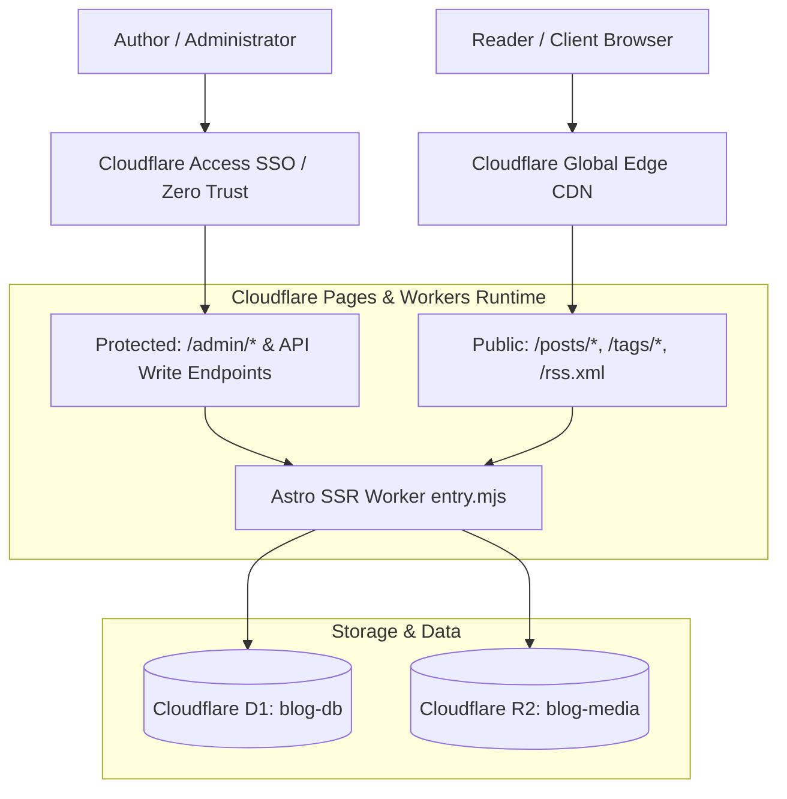

# Cloudflare Deployment Plan: Database (D1), Media (R2), and Blog UI (plan2.md)

This deployment plan outlines the architecture, step-by-step execution path, and commands required to deploy the refined Blog application, Cloudflare D1 SQL database, Cloudflare R2 bucket, and Cloudflare Access Zero Trust security to production.

---

## 1. Architectural Blueprint for Production



---

## 2. Prerequisites & Cloudflare Resources Checklist

To deploy to production, the following Cloudflare resources need to be created or provided:

| Resource | Resource Name | Production Environment Variable / Binding |
| :--- | :--- | :--- |
| **Cloudflare Account** | User Account ID | Set via `CLOUDFLARE_ACCOUNT_ID` or Wrangler interactive login |
| **D1 Database** | `blog-db` | Binding: `DB` |
| **R2 Storage Bucket** | `blog-media` | Binding: `BUCKET` |
| **Pages Project** | `blog` | Cloudflare Pages with SSR Worker entrypoint |
| **Cloudflare Access App** | `blog.akib35.me/admin/*` | `CLOUDFLARE_TEAM_DOMAIN` & `CLOUDFLARE_ACCESS_AUD` |

---

## 3. Step-by-Step Deployment Execution Guide

### Step 1: Cloudflare Authentication
You can authenticate with Cloudflare either via interactive login or by exporting an API token:

```bash
# Option A: Interactive login in your terminal
wrangler login

# Option B: Headless CI/CD / API Token
export CLOUDFLARE_API_TOKEN="your-api-token-here"
export CLOUDFLARE_ACCOUNT_ID="your-account-id-here"
```

---

### Step 2: Provision Cloudflare D1 Database
Create the production D1 database:

```bash
cd apps/blog
pnpm exec wrangler d1 create blog-db
```

*Output will provide your `database_id` (UUID). Update `apps/blog/wrangler.toml` with this UUID:*

```toml
[[d1_databases]]
binding = "DB"
database_name = "blog-db"
database_id = "<YOUR_PRODUCTION_D1_UUID>"
```

---

### Step 3: Run Production Database Migrations & Seed Data
Execute the initial SQL migration and seed articles onto the remote D1 database:

```bash
# 1. Execute schema migrations on remote D1
pnpm exec wrangler d1 execute blog-db --remote --file=../../packages/db/migrations/0000_initial.sql

# 2. Seed initial articles, tags, and sample comments on remote D1 (optional)
pnpm exec wrangler d1 execute blog-db --remote --file=../../packages/db/src/seed.sql
```

---

### Step 4: Provision Cloudflare R2 Storage Bucket
Create the remote R2 bucket for zero-egress media hosting:

```bash
pnpm exec wrangler r2 bucket create blog-media
```

---

### Step 5: Configure Production Environment Variables
Set the production environment variables in `apps/blog/wrangler.toml` or directly in Cloudflare Pages dashboard:

```toml
[vars]
SITE_URL = "https://blog.akib35.me"
DEV_MODE = "false"
R2_PUBLIC_DOMAIN = "https://media.akib35.me" # Or use default /api/media proxy
CLOUDFLARE_TEAM_DOMAIN = "<your-team>.cloudflareaccess.com"
CLOUDFLARE_ACCESS_AUD = "<your-access-aud-tag>"
```

---

### Step 6: Deploy the Blog Application to Cloudflare Pages
Build the production assets and deploy the Astro SSR Worker to Cloudflare Pages:

```bash
# 1. Run typechecks and test suite
pnpm test

# 2. Build production assets
pnpm build

# 3. Deploy to Cloudflare Pages
pnpm exec wrangler pages deploy dist/server --project-name=blog --commit-dirty=true
```

---

### Step 7: Cloudflare Access (Zero Trust) Configuration
To lock down `/admin/*` and administrative API endpoints:

1. In the **Cloudflare Zero Trust Dashboard**, go to **Access** -> **Applications**.
2. Click **Add an Application** -> **Self-Hosted**.
3. Set Application Domain: `blog.akib35.me/admin/*` and `blog.akib35.me/api/posts/*` (for `POST`, `PUT`, `DELETE`).
4. Set Identity Provider: GitHub / Google / One-Time PIN.
5. Create a Policy: Action = `Allow`, Selector = `Emails` -> `admin@akib35.me`.
6. Copy the **Application AUD Tag** and set it as `CLOUDFLARE_ACCESS_AUD` in your Cloudflare Pages variables.

---

## 4. Verification & Post-Deployment Checklist

- [ ] `GET https://blog.akib35.me/` — Returns status 200 with all articles loaded from remote D1.
- [ ] `GET https://blog.akib35.me/posts/<slug>` — Correctly renders Editor.js blocks, syntax-highlighted code, TOC, and comments.
- [ ] `GET https://blog.akib35.me/rss.xml` — Valid RSS feed output.
- [ ] `GET https://blog.akib35.me/admin` — Redirects unauthenticated visitors to Cloudflare Access login.
- [ ] `POST https://blog.akib35.me/api/comments` — Allows public readers to submit comments with moderation approval pending.
